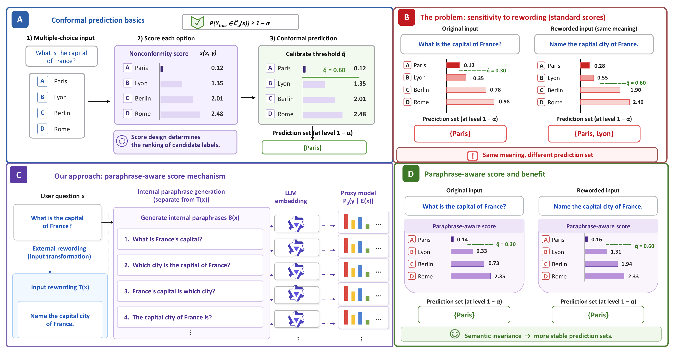
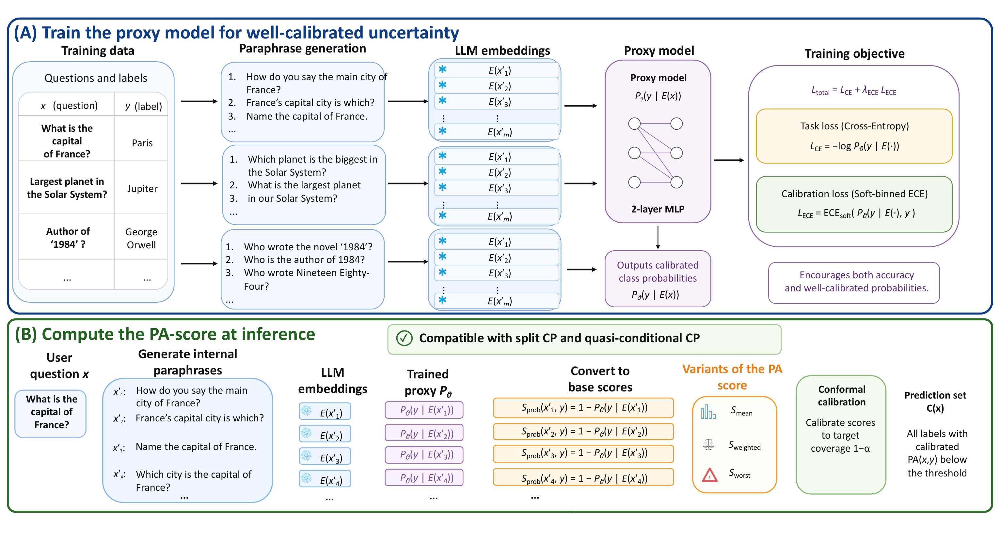

# Conformal Prediction with Paraphrase-Aware Scoring for LLM Uncertainty Quantification

[](https://neurips.cc/Conferences/2026)

Official implementation of [**Conformal Prediction with Paraphrase-Aware Scoring for LLM Uncertainty Quantification**](https://arxiv.org/abs/2610.04239), accepted as a poster at NeurIPS 2026.

**Authors:** [Jiayi Xin](https://raina-xin.github.io/), Evan Qiang, Zihan Zhu, [Xiang Li](https://lx10077.github.io/), [Weijie J. Su](https://www.weijie-su.com/), and [Qi Long](https://www.med.upenn.edu/long-lab/).
**Research Blog:** [Link to blog post](https://raina-xin.github.io/research-blog/pa/)

## Overview

Uncertainty quantification (UQ) for large language models (LLMs) aims to provide reliable measures of predictive confidence, yet current methods often fail to remain stable under simple, meaning-preserving perturbations. We identify an important source of instability: semantically equivalent paraphrases of the same input can induce substantial variability in predictive confidence, even for methods with formal guarantees such as conformal prediction. To address this issue, we propose a paraphrase-aware UQ framework designed to reduce changes in label-wise scores and prediction sets under semantic rewordings. Instead of relying on a single input, our approach trains a lightweight proxy model on LLM hidden states and aggregates its predictions across a set of paraphrases. The resulting scores can be combined with conformal calibration to retain marginal coverage under exchangeability. Coverage when only test inputs are reworded requires an additional condition. Across multiple UQ benchmarks and model families, the full method produces compact prediction sets with empirical coverage generally near the nominal target. A factorized ablation shows that the learned proxy drives most of the set-size reduction, while paraphrase-augmented training and inference-time aggregation reduce sensitivity to wording.

## Method at a Glance



**Figure 1 — Why paraphrase-aware scoring?** The top panels introduce conformal prediction and show how rewording a question without changing its meaning can change the prediction set under a standard score. The bottom panels illustrate our approach: generate internal paraphrases, score their LLM representations with a proxy, and aggregate those scores. In the illustrated example, the PA score yields the same prediction set for the two wordings.



**Figure 2 — How the method works.** (A) Train a two-layer proxy on frozen LLM representations of paraphrased questions, using cross-entropy together with a soft-binned calibration loss. (B) At inference, turn the proxy's per-answer outputs into base nonconformity scores, aggregate them across paraphrases using a PA-score variant (`S_mean`, `S_weighted`, or `S_worst`), and calibrate the resulting scores to form a prediction set. The diagram shows how this score fits into split CP and QCCP.


## Key Features

- **Paraphrase Generation**: Automatic generation of question paraphrases using LLMs
- **Proxy Model Training**: Lightweight neural networks trained on hidden representations to approximate LLM behavior
- **Paraphrase-Aware Scoring**: Novel scoring functions that measure prediction variability across paraphrases
- **Conformal Prediction**: Integration with both standard and conditional conformal prediction methods (QCP / QCCP)
- **Comprehensive Evaluation**: Support for multiple datasets and three evaluation modes (clean, semi-reworded, fully-reworded)

## Models

The main pipeline is run with **`Qwen/Qwen3-8B`** as the answer model and hidden-representation extractor. The paraphrase generator can be the same model or a different one (e.g. `meta-llama/Llama-3.1-8B-Instruct` for the cross-LLM ablation in the appendix). Cross-LLM Table-2 experiments additionally use `meta-llama/Llama-3.1-8B-Instruct` and `microsoft/Phi-3-small-8k-instruct` as answer models.


## Installation

```bash
# Clone the repository
git clone <repository-url>
cd PA_Score

# Install dependencies
pip install -r requirements.txt
```

## Quick Start

### 1. Generate Question Paraphrases

```bash
python 01_generate_question_paraphrase.py \
    --config_path configs/cosmosqa_10k.yaml \
    --model "Qwen/Qwen3-8B" \
    --debug
```

### 2. Generate Hidden Representations

```bash
# Clean paraphrases:
python 02_generate_hidden_representation.py \
    --model "Qwen/Qwen3-8B" \
    --data_path data \
    --dataset_name cosmosqa_10k \
    --paraphrase_dir paraphrased_questions \
    --output_dir outputs_hidden_reps \
    --few_shot 2

# Adversarially-reworded paraphrases (semi / fully reworded settings):
python 02a_generate_hidden_representation_adversarial.py \
    --model "Qwen/Qwen3-8B" \
    --data_path data \
    --dataset_name cosmosqa_10k \
    --adversarial_question_dir adversarial_questions \
    --adversarial_paraphrase_dir adversarial_question_paraphrases \
    --output_dir outputs_hidden_reps_adversarial \
    --few_shot 2
```

### 3. Create Train/Calibration/Test Splits

```bash
python 03_generate_calib_test_split.py \
    --config_path configs/cosmosqa_10k.yaml \
    --train_fraction 0.4 \
    --calib_fraction 0.3 \
    --test_fraction 0.3 \
    --seed 42
```

### 4. Train Proxy Model

```bash
python 04_train_proxy_model.py \
    --train_ids calib_test_splits/train_ids_cosmosqa_10k_tr0p4_cf0p3_tf0p3.json \
    --hidden_reps outputs_hidden_reps/cosmosqa_10k_Qwen3-8B_results.pkl \
    --ground_truth_json data/cosmosqa_10k.json \
    --batch_size 64 \
    --epochs 50
```

### 5. Calculate Paraphrase-Aware Scores

```bash
python 05_calculate_paraphrase_aware_score.py \
    --proxy_model_path proxy_models/proxy_model_clean_cosmosqa_10k_Qwen3-8B.pth \
    --hidden_reps_file outputs_hidden_reps/cosmosqa_10k_Qwen3-8B_results.pkl \
    --output_dir output_score
```

### 6. Run Uncertainty Quantification

```bash
# QCP (intercept) on the clean setting:
python 06_uncertainty_quantification_via_qcp.py \
    --model "Qwen/Qwen3-8B" \
    --data_names cosmosqa_10k \
    --use_pa --pa_metric S_mean \
    --pa_score_path_template "output_score/clean/proxy_model_clean_{data_name}_Qwen3-8B_paraphrase_variability_scores.json" \
    --split_manifest_template "calib_test_splits/split_manifest_{data_name}_tr0p4_cf0p3_tf0p3.json" \
    --phi_mode intercept

# QCCP (cluster_sbert) on the clean setting:
python 06_uncertainty_quantification_via_qcp.py \
    --model "Qwen/Qwen3-8B" \
    --data_names cosmosqa_10k \
    --use_pa --pa_metric S_mean \
    --pa_score_path_template "output_score/clean/proxy_model_clean_{data_name}_Qwen3-8B_paraphrase_variability_scores.json" \
    --split_manifest_template "calib_test_splits/split_manifest_{data_name}_tr0p4_cf0p3_tf0p3.json" \
    --phi_mode cluster_sbert --clusters 20

# QCCP for the SEMI-REWORDED setting requires the cluster encoder to read the
# reworded question text on both calibration and test sides (otherwise the
# (Phi, score) pair is not exchangeable across calib/test). Pass the
# clean-paraphrase directory as the cluster source:
python 06_uncertainty_quantification_via_qcp.py \
    --model "Qwen/Qwen3-8B" \
    --data_names cosmosqa_10k \
    --use_pa --pa_metric S_mean \
    --pa_score_path_template "output_score/semi/proxy_model_semi_{data_name}_Qwen3-8B_paraphrase_variability_scores.json" \
    --split_manifest_template "calib_test_splits/split_manifest_{data_name}_tr0p4_cf0p3_tf0p3.json" \
    --phi_mode cluster_sbert --clusters 20 \
    --cluster_paraphrase_dir paraphrased_questions \
    --cluster_paraphrase_index 0
```

## Pipeline Overview

The system follows a 6-step pipeline (with two auxiliary scripts for the adversarial / reworded settings):

1. **Paraphrase Generation** (`01_*`): Generate multiple paraphrases for each question using an LLM
2. **Hidden Representation Extraction** (`02_*` clean, `02a_*` adversarial): Extract hidden representations for original and paraphrased questions
3. **Data Splitting** (`03_*`): Split data into train/calibration/test sets
4. **Proxy Model Training** (`04_*`): Train lightweight models on hidden representations
5. **Score Calculation** (`05_*`): Compute paraphrase-aware predictive variability scores
6. **Conformal Prediction** (`06_*`): Apply conformal prediction with paraphrase-aware scores (QCP / QCCP)

Two auxiliary regenerators produce the adversarial inputs:

- `00_generate_adversarial_questions.py` / `10_regenerate_clean_adversarial_questions.py` — rewrite each question into an adversarial (semantically-equivalent) form.
- `11_regenerate_clean_adversarial_question_paraphrases.py` — generate paraphrases of the adversarial questions, with an explicit `--n_perturb` flag that overrides the dataset YAML's `n_perturb` field.

## Key Components

### Paraphrase-Aware Scoring

The system implements three types of paraphrase-aware scores:

- **S_mean**: Average prediction variability across paraphrases
- **S_weighted**: Distance-weighted prediction variability
- **S_worst**: Worst-case prediction variability

### Proxy Models

Lightweight 2-layer MLPs trained on LLM hidden representations to approximate the model's softmax distribution while being computationally efficient.

### Conformal Prediction Methods

- **LAC / APS**: Standard conformal prediction with Least Ambiguous set-valued Classifier / Adaptive Prediction Sets
- **PA_CP**: Paraphrase-aware split conformal prediction
- **PA_QCP**: Paraphrase-aware conditional conformal prediction (`--phi_mode intercept`)
- **PA_QCCP**: Cluster-conditional QCP using SBERT KMeans on the question text (`--phi_mode cluster_sbert`)

### Evaluation Modes

- **Clean (Normal)**: calib and test both drawn from the original question distribution.
- **Fully-reworded (Full)**: calib and test both drawn from the adversarially-reworded distribution.
- **Semi-reworded**: calib drawn from original, test drawn from the reworded distribution. For QCCP, the cluster Phi must be evaluated on the reworded text on both sides — pass `--cluster_paraphrase_dir` to point at the reworded JSONs.

## Datasets

The system supports seven datasets:

- MMLU (10k subset)
- CosmosQA (10k subset)
- HellaSwag (10k subset)
- Halu-Dialogue
- Halu-Summarization
- MedMCQA (10k subset)
- MedQA (10k subset)

## Configuration

Configuration files are located in `configs/` (clean) and `adversarial_config/` (adversarial). Each dataset has its own configuration file specifying:

- Model settings
- Paraphrase generation parameters (`n_perturb`, sampling temperature, `max_tokens`, ...)
- Evaluation settings
- Data paths

## Evaluation Metrics

- **Coverage**: Empirical coverage rate of prediction sets at α=0.1 (target 90%).
- **Set Size**: Average size of prediction sets (smaller is better at matched coverage).

## File Structure

```
PA_Score/
├── 00_generate_adversarial_questions.py     # Adversarial-question generation
├── 01_generate_question_paraphrase.py       # Clean paraphrase generation
├── 02_generate_hidden_representation.py     # Hidden-rep extraction (clean)
├── 02a_generate_hidden_representation_adversarial.py  # Hidden-rep extraction (adversarial)
├── 03_generate_calib_test_split.py          # Train/calib/test splits
├── 04_train_proxy_model.py                  # Proxy model training
├── 05_calculate_paraphrase_aware_score.py   # PA score calculation
├── 06_uncertainty_quantification_via_qcp.py # QCP / QCCP main entry
├── 06ab_uq_via_qcp_llm.py                   # API-only QCP variant
├── 05ab_calculate_paraphrase_aware_score_llm_ablation.py  # API-only PA scores
├── compare_proxy_vs_llm_calibration.py      # Proxy vs LLM calibration comparison
├── adversarial_config/                      # Configs for adversarial mode
├── configs/                                  # Configs for clean mode
├── qcp/                                      # QCP / SBERT clustering implementation
├── data_utils.py                             # Data loading utilities
├── ece_losses.py                             # Calibration loss functions
├── models.py                                 # Proxy model definition
├── prompt.py                                 # Prompt templates
└── requirements.txt                          # Dependencies
```

## Citation
```
@article{xin2026conformal,
  title={Conformal Prediction with Paraphrase-Aware Scoring for LLM Uncertainty Quantification},
  author={Xin, Jiayi and Qiang, Evan and Zhu, Zihan and Li, Xiang and Su, Weijie J and Long, Qi},
  journal={arXiv preprint arXiv:2610.04239},
  year={2026}
}
```

## Acknowledgments

This work builds upon and adapts code from:

- Cox et al. (2025) for paraphrase generation prompts
- Ye et al. (2024) for uncertainty quantification baselines
- Google's uncertainty-baselines for ECE loss implementations
